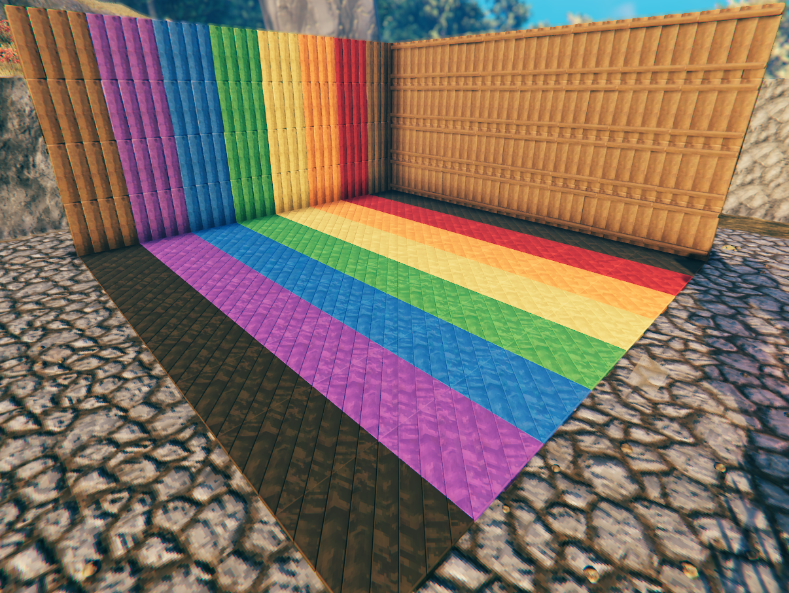
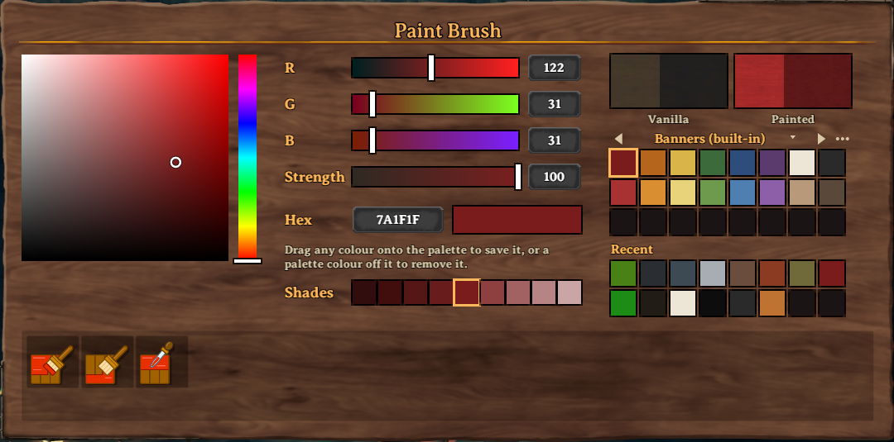
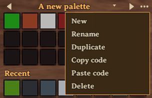
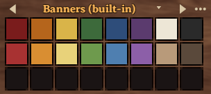
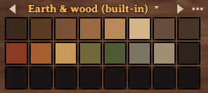
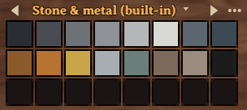
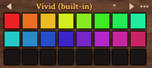

# PaintBrush

Paint your buildings: a paint brush, taken out with one key, colours built pieces in any shade and strength, and clears them back to vanilla. Only players with the mod see the paint.

- **Paint brush**: Press `O` to take out the brush, and again to put it away. It doesn't need to be crafted or carried.
- **Paint and clear**: Paint any piece built by a player, or clear it back to vanilla. The piece shows the result while you aim at it, and a splash of paint lands where you click.
- **Colour picker**: Choose any colour and how strongly it covers the piece in the brush menu, with shades of it to pick from.
- **Palettes**: Save colours by dragging them onto a palette, switch between palettes, build on the built-in ones, and share them with a code.
- **Wood and stone stay wood and stone**: The paint keeps the grain and texture of every piece, and dark pieces can still be painted light.
- **Pick colour**: Take the colour of any piece, painted or not.
- **Connected pieces**: Paint or clear a whole building in one click with `Alt+Left-Click`.
- **Undo and redo**: Undo painting with `Ctrl+Z` and redo it with `Ctrl+Y`.

## Paint Menu

`Right-Click` with the brush out opens the brush menu.

- **Paint** colours the piece you click with the colour and strength set in the picker.
- **Clear paint** removes the paint, so the piece looks vanilla again.
- **Pick colour** is an eyedropper: it takes the paint of the piece you click, or its vanilla colour if it isn't painted, then switches back to Paint. `Shift+Left-Click` always takes the vanilla colour.

Choose a colour with the colour square and hue bar, the R, G and B sliders, or by typing its numbers or hex code.
**Strength** blends between the piece's own colour and the paint: low strength tints it, 100% covers it.

The **Shades** row shows darker and lighter shades of the selected colour.
**Recent** shows the colours you last painted with.

### Palettes

A palette holds 24 saved colours, and the slot matching your current colour has a gold outline.
Step through your palettes with the arrows on either side of its name, or click the name to pick one from a list.

| Key | Action |
|---|---|
| `Left-Click` a swatch | Use a palette, shade or recent colour. |
| Drag a colour onto a palette slot | Save it there. Any swatch can be dragged, including the current colour bar. |
| Drag a palette colour onto another slot | Swap the two. |
| Drag a palette colour off the palette | Remove it. |
| `Shift+Left-Click` a palette slot | Save the current colour there. |
| `Right-Click` a palette slot | Empty it. |

### Palette Menu

The `⋯` button next to the palette's name opens the palette menu.

- **New** makes an empty palette and asks for its name.
- **Rename** changes the name of one of your palettes.
- **Duplicate** makes a copy of the palette in use, which you can then change.
- **Copy code** puts the palette in the clipboard as one line of text, such as `PB1:Banners:7A1F1F,B5651D,...`, to send to a friend.
- **Paste code** adds a palette from a code in the clipboard.
- **Delete** removes one of your palettes. Click it twice, as a deleted palette can't be brought back.

### Built-in Palettes

The mod comes with four built-in palettes. They can't be changed, renamed or deleted, so to make one your own, **Duplicate** it and edit the copy, which has a free row for your own colours.

| Banners | Earth & wood |
|---|---|
|  |  |
| **Stone & metal** | **Vivid** |
|  |  |

### Saving

Your palettes are shared by all your characters and saved in `BepInEx/config/javidahmed64592.paintbrush.palettes.json`, which can be edited by hand while the game is closed.
Each character remembers which palette it used, and saves its own colour and recent colours.

## Painting

| Key | Action |
|---|---|
| `Left-Click` | Use the selected tool on the piece you aim at. |
| `Alt+Left-Click` | Paint or clear the piece and every piece connected to it. Hold `Alt` to preview it first. |
| `Ctrl+Z` | Undo the last painting or clearing. |
| `Ctrl+Y` | Redo the last painting or clearing you undid. |

- Painting needs access to the area, like building: pieces inside someone else's ward can't be painted, and `Alt+Left-Click` leaves them out.
- Pieces count as connected when they touch, as in [BetterHammer](https://thunderstore.io/c/valheim/p/Aestelwen/BetterHammer/)'s connected selection. One click paints at most 1000 pieces by default.
- The history holds 50 actions by default and lasts until you log out.

## Keyhints

While the brush is out, the key hints show what each key does with the selected tool, with `Alt+Left-Click`, undo and redo above them.

## Configuration

Settings are in the BepInEx config file `javidahmed64592.paintbrush.cfg`: the keys, the largest size of painted textures (smaller saves memory, larger is sharper up close), the most pieces `Alt+Left-Click` paints at once, and how many actions can be undone.

## Compatibility

- The paint is saved on the pieces, but only players with the mod see it. Players without the mod, and servers, don't need it; they see the pieces as vanilla.
- Pieces from other mods can be painted if they use ordinary textures.
- Works with Valheim Performance Optimizations: painted pieces are drawn normally instead of in its batches, so they show their paint.
- Works alongside [BetterHammer](https://thunderstore.io/c/valheim/p/Aestelwen/BetterHammer/) and [BetterHoe](https://thunderstore.io/c/valheim/p/Aestelwen/BetterHoe/): `B` takes out the hammer, `N` the hoe and `O` the brush.
- With BetterHammer 1.4.0 or later, paint goes wherever its pieces do: saved copies keep it, ghosts show it while moving or placing, and undo puts it back.
- This mod has not been tested with a gamepad, only with keyboard and mouse.

## Uninstalling

The paint stays saved on the pieces, but nobody sees it without the mod, so it can be removed at any time. Reinstalling shows the paint again.

## License

This project is licensed under the MIT License - see the [LICENSE](https://github.com/javidahmed64592/Valheim-PaintBrush/blob/main/LICENSE) file for details.
